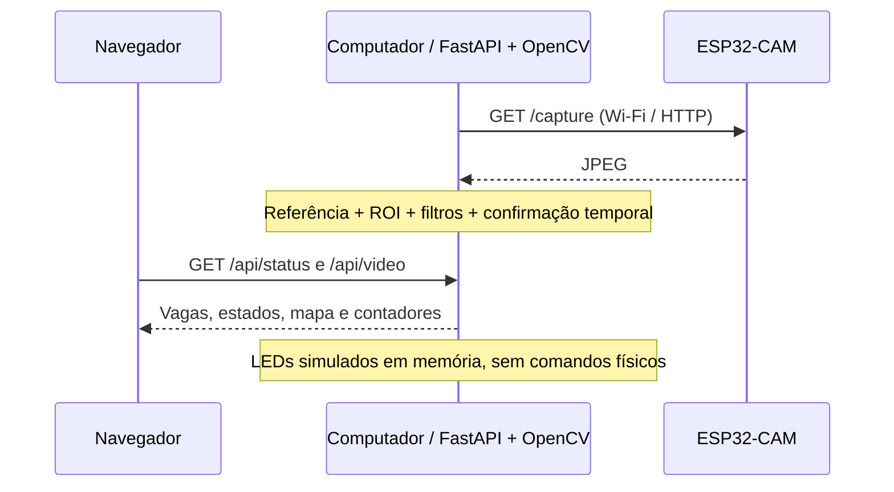

# Arquitetura planejada

Implementados GET /capture e GET /health na ESP32-CAM, cliente HTTP e comando de
aquisição no computador. Após a confirmação da câmera, o usuário autorizou vídeo
contínuo e ensaio de ocupação: há painel HTML/JS, API FastAPI, vídeo MJPEG e detector
OpenCV no computador. Rotas atuais estão em [teste-ocupacao.md](teste-ocupacao.md).
Os contratos /api/v1 e controle físico de LEDs abaixo continuam propostas.

## Componentes e fluxo



O computador inicia ambas as comunicações com o dispositivo. Usaremos capturas
JPEG individuais por consulta periódica, sem streaming MJPEG inicialmente.
Isso permite limitar a frequência e associar um instante a cada análise.
O firmware captura, codifica/transmite e aciona LEDs; não classifica vagas.

O backend é a fonte do estado atual e serve o frontend na mesma origem. O navegador
consulta o estado a cada 500 ms e recebe MJPEG continuamente de um cache compartilhado.
Somente uma thread consulta a câmera; abrir novos vídeos não cria novas aquisições.
O desenho real do mapa ainda não foi implementado.
Não é necessário Node.js, banco de dados, MQTT ou WebSocket no escopo inicial.

## Contratos HTTP propostos

| Servidor | Método/caminho | Uso |
| --- | --- | --- |
| ESP32-CAM | `GET /capture` | JPEG completo com Content-Type image/jpeg, sem cache |
| ESP32-CAM | `GET /health` | Diagnóstico camera_ready; 503 se inicialização falhou |
| ESP32-CAM | `POST /leds` | Receber todos os estados/índices dos LEDs em JSON |
| Backend | `GET /api/v1/parking` | Cadastro, mapa, estados e contadores |
| Backend | `PUT /api/v1/spots/{id}/state` | Teste manual, apenas em modo manual |
| Backend | `GET /api/v1/camera/snapshot` | Última imagem para o editor |
| Backend | `PUT /api/v1/config/parking` | Validar e salvar cadastro/calibração |
| Backend | `POST /api/v1/reference` | Salvar referência vazia por ação explícita |

O payload de LEDs será idempotente: repetir o mesmo conteúdo mantém as cores.
Exemplo de formato abreviado para uma vaga:

```json
{
  "schema_version": 1,
  "leds": [{"index": 0, "state": "unknown", "rgb": [255, 180, 0]}]
}
```

O backend enviará o conjunto completo nas mudanças, reconexão e periodicamente
como heartbeat. Resposta HTTP confirmará recebimento/aplicação pelo firmware,
sem significar que a luz física foi observada.

A resposta do estacionamento deverá conter `spots`, `counts`, `updated_at`,
`camera_online`, `source` (manual/automatic) e `led_mode`. Cada vaga incluirá
`id`, `map_rect`, `led_index`, `state` e instante da última análise válida.
Os contadores terão total, livres, ocupadas e desconhecidas, com soma igual ao
total. Datas da API usarão ISO 8601 em UTC; a UI poderá exibir horário local.

O editor salvará regiões e geometria, não estados de operação. A referência
exigirá confirmação de que todas as vagas estão vazias. Não criar referência
automaticamente ao iniciar.

## Estado, perdas e simulação

Estados: free (verde), occupied (vermelho) e unknown (amarelo/cinza).
Ao iniciar, sem referência, sem ROI calibrada ou com captura vencida, usar unknown.
A configuração armazena apenas o estado inicial; estados atuais ficarão em memória
no backend. Reiniciar não deve restaurar um estado antigo como se fosse atual.

Em modo manual, mudanças virão de ações explícitas de teste. Em modo automático,
somente o detector poderá alterar ocupação. A origem deverá aparecer na UI.
O backend manterá sequência e tempo de validade para descartar resultados antigos.

Falha de captura ou análise inválida interromperá a confirmação de mudanças.
Após stale_after_seconds, vagas afetadas ficarão desconhecidas. A UI também deverá
indicar dados vencidos se perder contato com a API. Falha de comunicação com LEDs
aparecerá separadamente do estado detectado. O firmware deverá colocar LEDs em
amarelo se não receber heartbeat no prazo.

LED_MODE=simulation usará um transporte local de registro no backend e não fará
requisições ao endpoint de LEDs. Captura real poderá ser usada com LEDs simulados.
O modo de simulação do painel registra estados e cores em memória; não acessa
/leds. O transporte físico permanece sem implementação.

## Detecção futura sem IA

Referência e captura deverão ter mesma dimensão, orientação e enquadramento.
Aplicar suavização, compensação de iluminação e análise de diferença por polígono.
A fração de pixels alterados será um indício, combinada com filtros, qualidade
do quadro e confirmação temporal. Uma diferença isolada não basta.

Usar limiares diferentes para livre e ocupado. A faixa intermediária será ambígua,
interromperá a confirmação e produzirá unknown se persistir além do prazo de
validade. Mudanças globais de iluminação ou deslocamento da câmera invalidarão
a análise; não atualizar a referência automaticamente com carros.

Sombras locais ainda poderão causar falsos positivos. A Etapa 6 medirá esse
comportamento; não há garantia de robustez ou precisão antes dos ensaios.

## Aquisição implementada na Etapa 2

CameraClient solicita uma imagem por chamada e entrega bytes JPEG e array BGR
decodificado no computador, sem determinar ocupação. received_at marca o fim
do recebimento no relógio UTC do computador, não o instante exato da exposição.
duration_seconds inclui rede e decodificação.

HTTP diferente de 200, redirecionamento, timeout e falhas de transporte são erros.
Content-Type incorreto, corpo excedente, marcadores JPEG ausentes ou falha de
decodificação também são rejeitados. Não retornar imagem anterior como captura
nova. Não há tentativas automáticas no comando CLI após uma captura falhar; uma nova
chamada do cliente ou execução do comando pode tentar novamente.
O produtor de imagens do painel tenta novamente após falhas, com pausa de pelo
menos 1 segundo, mantendo estados desconhecidos até a recuperação.

HTTPX usa timeout por operação de rede (conexão/leitura/escrita/pool), conforme
sua [documentação](https://www.python-httpx.org/advanced/timeouts/).
Não é um limite global de duração. Proxies de ambiente e redirecionamentos ficam
desativados para a comunicação direta com o dispositivo.

As rotas da ESP32-CAM são HTTP sem autenticação, para teste na rede local.
Não configurar encaminhamento de porta para a internet.
